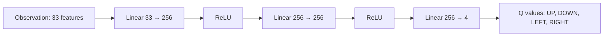
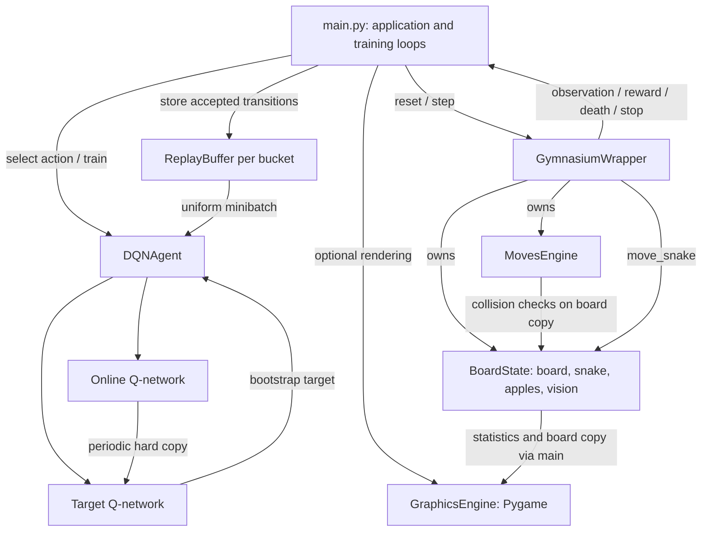
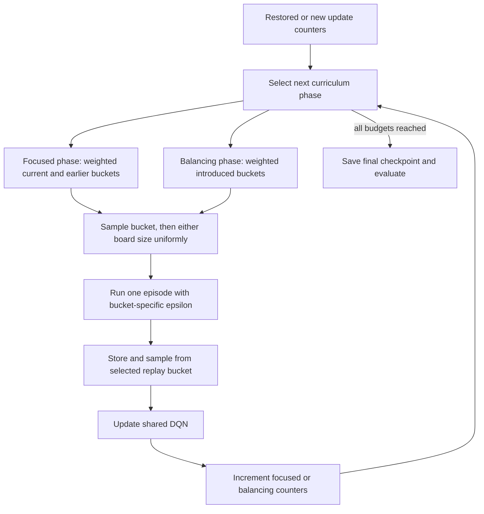

# Learn2Slither

**One DQN policy. Variable-size Snake. No per-board retraining.**

Learn2Slither trains a single deep reinforcement learning agent to **play on any supported square board size (5×5 to 500×500)** without changing the network or training a separate model for each size. The shared policy learns through a 20-board curriculum; it can also receive observations from board sizes it has never explicitly trained on.

Built with PyTorch, Learn2Slither combines a Deep Q-Network (DQN), a custom Snake environment, bucket-specific experience replay, and a staged curriculum. It supports checkpoint restoration, evaluation, and a Pygame interface for playing, watching, and inspecting the agent. **Training coverage and board-size support are different:** the reported curriculum experiments cover 20 sizes from 5×5 to 100×100, while the environment accepts any integer square size from 5 to 500. Successful play on untrained sizes is a goal, not a measured guarantee.

| Model | Evaluation scope | Mean score | Best score |
|---|---|---:|---:|
| Specialized checkpoint | 250 games on 10×10 | **19.39** | 39 |
| Curriculum checkpoint | 2,000 games across 5×5–100×100 | **32.31** | 79 |

These are separate experiments totaling **2,250 evaluation games**. The pooled multi-board mean is not directly comparable to the fixed-board mean; see [Performance & Evaluation](#performance--evaluation).

## Table of Contents

- [Overview](#overview)
- [Board-size independence](#board-size-independence)
- [Architecture](#agent-architecture)
- [Curriculum](#curriculum-learning-and-multi-board-training)
- [Installation](#installation)
- [Usage](#usage)
- [Results](#performance--evaluation)
- [Project structure](#project-structure)

## Overview

The agent learns action values from interactions: it observes the board, chooses a direction, receives a reward, and stores the resulting transition for later learning. Green apples reward growth; red apples shrink the snake and reduce its score; collisions incur a larger penalty. The policy is learned through neural-network optimization rather than a predefined route or a scripted apple-chasing rule.

Different board sizes change the available space, distances to food, and opportunities for collisions and repetitive movement. Learn2Slither addresses this with a **33-feature, size-aware observation** that always has the same shape, regardless of the board dimensions. One shared network can therefore choose actions on different boards—including sizes outside its training curriculum—without resizing its layers or loading a separate policy. The curriculum progressively introduces larger boards while revisiting earlier sizes. This enables board-size-independent inference by design; how well the agent performs on unseen sizes still requires evaluation.

### Board-size independence

**The goal is to train once and play across board sizes, not to train a separate agent for each board.** A 33-dimensional observation captures normalized directional information and a board-size signal, allowing the same DQN to accept states from any supported square board. The network always produces four Q-values—one per movement direction—regardless of `N`.

| Scope | What it means |
|---|---|
| **Supported game sizes** | Any integer `N` from 5 to 500 for an `N × N` square board |
| **Curriculum sizes** | 20 boards: 5×5, 10×10, …, 100×100 |
| **Evaluated sizes** | The same 20 boards, 100 evaluation games per board |
| **Other supported sizes** | The same model can be run without retraining; performance on these sizes is not established by the reported benchmarks |

For example, the curriculum checkpoint can run on 12×12, 37×37, or 120×120 without retraining. The [usage examples](#run-the-same-policy-on-other-board-sizes) show how; no scores for these unseen sizes are claimed here.

### Features

- **DQN training:** action-value estimation, uniform experience replay, a separate target network, Smooth L1 loss, Adam, and gradient clipping.
- **Board-size-independent policy:** a single DQN accepts a fixed 33-feature observation for any configured square board size (5–500); no per-size network or checkpoint is required.
- **Multi-board curriculum:** ten buckets spanning twenty square boards, weighted phase sampling, and interleaved balancing phases.
- **Two training modes:** a configured number of episodes on one board, or curriculum completion based on optimizer-update budgets.
- **Checkpoint persistence:** online and target networks, optimizer state, episode counters, and curriculum progress.
- **Evaluation:** per-board, per-bucket, and pooled statistics, including scores, maximum lengths, ending reasons, and episode steps.
- **Interactive inspection:** human play, greedy or exploratory agent play, a separate visual training mode, adjustable speed, single-step control, and terminal vision output.
- **Device selection:** CUDA when available through PyTorch; CPU otherwise.

## Snake Environment

The environment stores an `N × N` square board as a flat NumPy array and the snake as a deque ordered from tail to head. `N` includes the outer wall, leaving an `(N − 2) × (N − 2)` playable interior. Configuration accepts sizes from **5 to 500**; the built-in curriculum and reported multi-board experiment cover **5 to 100 in increments of 5**.

Each reset places a randomly positioned, contiguous three-cell snake, **two green apples**, and **one red apple**. Apples spawn uniformly on empty cells. Consumed apples are replaced; if no empty cell is available, replacement stays pending until space becomes available.

Actions are absolute directions: **up, down, left, right**. Movement advances one cell. Although the position calculation uses modular arithmetic, border walls prevent normal wraparound play. Collision checking rejects walls and ordinary body segments before movement; tail entities are not included in that collision test. There is no explicit reverse-action mask.

### Rewards and score

Rewards are additive and distinct from the displayed score:

| Event | Default reward contribution | Game effect |
|---|---:|---|
| Every step | −0.01 | Ordinary movement preserves length |
| Green apple | +5.00 | Length +1; score +1 |
| Red apple | −1.00 | Length −1; score decreases by 1, floored at zero |
| Death | −10.00 | Ends the episode |
| New cell with no green apple visible, in training-enabled steps | +0.01 | Exploration shaping; no score change |

The exploration bonus applies only on nonfatal steps without a green-apple pickup. At the defaults it exactly cancels the step penalty on qualifying steps. It is fixed in code, while the other reward contributions have CLI settings. Score starts at zero and is updated after each apple, so it is neither accumulated reward nor simply final length.

### Death, Stopped, and Capped

The evaluator calls `env.step(..., training=True)`, enabling the same progress tracking and truncation rules used in batch training.

| Reported ending | Actual condition |
|---|---|
| **Death** | Wall/body collision, or the snake becomes empty after shrinking |
| **Stopped** | Environment truncation: stagnation **or** the episode step limit |
| **Capped** | Evaluator exhausts its own loop limit without receiving death or stop |

Progress tracking resets after a green apple. Between pickups, progress means visiting a new head position, first detecting a green apple on any ray, or improving the best unobstructed green-apple proximity. A step with none of those events increments the stagnation counter. The environment stops after `max(100, 3 × N)` consecutive non-progress steps, or after `max(1,000, N²)` total episode steps.

The evaluator also uses `max(1,000, N²)` as its loop limit. With the current implementation, a live episode reaching that limit signals `Stopped` before it could be classified as `Capped`; death takes precedence if it occurs on that step. **Stopped does not mean success or indefinite survival.** The reports do not separate stagnation stops from step-limit stops. There is no explicit board-completion win condition.

Interactive play calls `step()` without training enabled, so these truncation rules and the exploration bonus do not apply there.

## Agent Architecture

### Observation: 33 normalized features

The policy sees four cardinal rays in **north, east, south, west** order. Rays extend to the wall and continue through body segments; separate features distinguish an apple somewhere on a ray from an unobstructed apple.

Each direction contributes eight features:

| Offset within each ray | Feature | Encoding |
|---:|---|---|
| 0 | Wall proximity | `1 − (distance − 1) / (N − 1)` |
| 1 | First body-segment proximity | Same normalization; 0 if absent |
| 2 | Second body-segment proximity | Same normalization; 0 if absent |
| 3 | First green-apple proximity | Same normalization; 0 if absent |
| 4 | First red-apple proximity | Same normalization; 0 if absent |
| 5 | Clear corridor length | Consecutive cells before wall/body, divided by `max(1, N − 3)` |
| 6 | Unobstructed green-apple proximity | Proximity before the first wall/body; 0 if absent |
| 7 | Visible body density | Body/tail cells divided by ray length, including the wall cell in the denominator |

Indices `0:8`, `8:16`, `16:24`, and `24:32` encode the four rays. Feature `32` encodes board size as `N / (N + 20)`, with `N` inferred from opposing ray lengths. The result is a `float32` vector in `[0, 1]`; death produces an all-zero observation.

**This fixed observation shape is what makes the policy independent of board dimensions at inference time.** The same `33 → 256 → 256 → 4` network can act on any supported square size, whether or not that size was in the curriculum. Normalization supports transfer across scales, but does not guarantee strong decisions on unseen boards. The observation does not expose the full board, off-axis apples, a movement history, or an explicit heading feature; distinct game states can therefore produce the same observation.

### Neural network



The online network has **75,524 trainable parameters**. Its four unconstrained outputs estimate `Q(s, a)`; there is no softmax. A second network with the same architecture supplies Bellman targets. Training uses epsilon-greedy actions; evaluation takes `argmax` with exploration disabled. The output order follows `Action`: up `0`, down `1`, left `2`, right `3`, which differs from the ray order.

### Current Architecture Vision

The application separates orchestration, learning, environment state, movement rules, and rendering. The entry point is `src/main.py`; `GymnasiumWrapper` owns `BoardState` and `MovesEngine`, while **the application owns the optional renderer**.



Despite its name, `GymnasiumWrapper` **does not subclass `gymnasium.Env`**. It uses Gymnasium spaces, but `reset()` returns no observation and `step()` returns `(observation, reward, is_dead, stop_training)`, not the standard Gymnasium five-element tuple. The training loop reads the initial observation from `env.board` after resetting.

## Reinforcement Learning Algorithm

The implementation uses standard DQN: the same target network selects and evaluates the maximum next-state action value. It does not implement Double DQN or prioritized replay.

For observation $s$ and action $a$, the online network estimates the discounted action value $Q_\theta(s,a)$. A sampled transition $(s_i,a_i,r_i,s'_i,d_i)$ has target:

$$
y_i = r_i + (1-d_i)\gamma \max_{a'} Q_{\theta^-}(s'_i,a')
$$

Here, $d_i=1$ means genuine death, so the terminal target is simply $y_i=r_i$. Targets are computed without gradients. The default discount factor is **0.995**.

The implemented objective is **Smooth L1**, not mean squared error. With PyTorch's default $\beta=1$, let $\delta_i=Q_\theta(s_i,a_i)-y_i$:

$$
L = \frac{1}{B}\sum_{i=1}^{B}\ell(\delta_i), \qquad
\ell(\delta)=\begin{cases}
\tfrac{1}{2}\delta^2 & |\delta|<1 \\
|\delta|-\tfrac{1}{2} & \text{otherwise}
\end{cases}
$$

### Replay and update cadence

Each of the ten buckets has a ring buffer with capacity **500,000 transitions**. Observations are copied when stored, preventing later environment mutation from changing replay entries. Sampling is uniform without replacement from the **currently selected bucket only**; there is no mixed-bucket minibatch. Once full, a buffer overwrites its oldest entries.

For the batch `TRAIN` loop:

1. Increment the global environment-step counter and take an epsilon-greedy action.
2. Step the environment with progress tracking enabled.
3. If the step triggers truncation, return immediately. **That final transition is not stored or trained on.**
4. Otherwise, store the transition with `done=is_dead`, including fatal transitions.
5. Every **10 environment steps**, attempt one update from the selected bucket, provided it has at least **128 transitions**.
6. Compute the Smooth L1 loss, backpropagate, clip global gradient norm to **5.0**, and take an Adam step at default learning rate **0.0001**.
7. Every **1,000 successful optimizer updates**, copy online weights to the target network.

`total_steps`, `bucket_steps`, and `balancing_steps` count **successful optimizer updates**, not moves or episodes. `env_steps` counts environment interactions separately. This distinction matters when interpreting curriculum budgets and checkpoint statistics.

### Exploration schedule

For curriculum bucket $b$:

$$
\epsilon_b = 0.01 + (\epsilon_{0,b}-0.01)(1-p_b)^{k_b},
\qquad p_b=\min\left(1,\frac{\text{bucket updates}_b}{\text{budget}}\right)
$$

| Bucket | 1 | 2 | 3 | 4 | 5 | 6 | 7 | 8 | 9 | 10 |
|---|---:|---:|---:|---:|---:|---:|---:|---:|---:|---:|
| Initial epsilon | 1.00 | 0.85 | 0.70 | 0.55 | 0.40 | 0.40 | 0.35 | 0.30 | 0.25 | 0.20 |
| Decay power | 1.50 | 1.75 | 2.00 | 2.25 | 2.50 | 2.50 | 2.75 | 3.00 | 3.25 | 3.50 |

Session-based training instead decays from `1.00` toward `0.01` with power `3.00`, based on completed episodes in the current invocation divided by `--training-sessions`. Random exploration chooses uniformly among all four actions; it does not filter unsafe moves.

## Curriculum Learning and Multi-Board Training

The scheduler in [`src/utilize/get_bucket_index.py`](src/utilize/get_bucket_index.py) groups adjacent sizes into ten buckets, from `[5, 10]` to `[95, 100]`. All buckets update **one shared online network and one shared target network**. Only replay storage and progress accounting are separated by bucket.



### Focused phases

The scheduler starts with Bucket 1 and advances in increasing bucket order. A bucket's default minimum is **2,000 focused optimizer updates**, controlled by `--total-steps`.

In each focused phase, `PHASE_WEIGHTS` selects the current or an earlier bucket. The current bucket receives weight `1.00` in phase 1, `0.65` in phase 2, `0.60` in phase 3, and `0.55` thereafter; remaining weight revisits earlier buckets. A board is chosen uniformly from the selected pair at the start of each episode.

This is a minimum-budget schedule, not an equal allocation: earlier buckets keep accumulating focused updates when revisited. Phase selection happens between episodes, so counters can overshoot thresholds. Episode lengths also affect how many updates each sampled board contributes. Progression is based on update counts, **not** score, mastery, or evaluation performance.

### Balancing phases

After completing each bucket from 2 onward, the scheduler inserts a balancing phase across buckets introduced so far. For one-based bucket index $j$, sampling weight is proportional to $1/\sqrt{j}$, favoring earlier buckets rather than equalizing update counts.

With budget $M$, intermediate balancing increments are `max(1, M // 4)`; the final increment is `M // 2`. At the default `M = 2,000`, eight intermediate increments plus the final increment target **5,000 balancing updates** in total. Episodes can overshoot these thresholds as well.

Balancing updates increase `total_steps` and `balancing_steps`, but **do not increase `bucket_steps`** or advance the focused-update epsilon schedule. They use the same per-bucket replay buffers and still collect fresh environment interactions. Replay separation makes bucket selection meaningful; revisiting earlier buckets is intended to retain earlier experience while introducing larger boards. No ablation here establishes that this schedule improves generalization.

### Checkpoints and restoration

Checkpoints serialize:

- Online and target network state dictionaries and Adam optimizer state.
- `last_episode`, `env_steps`, and total optimizer updates.
- Per-bucket focused updates and the global balancing-update count.

Curriculum phase selection is reconstructed from these counters and the current budget. **Replay contents, losses, random-number states, configuration, per-bucket balancing counters, and session exploration progress are not saved.** Resuming therefore restores learning state and curriculum accounting, but is not an exact continuation of the previous trajectory. Session mode resets its episode-based epsilon schedule and runs the newly requested number of additional episodes.

The current batch trainer saves only at normal completion, as `snake_sessions_final.pth` or `snake_curriculum_final.pth`. It does not automatically select a “best” checkpoint, save intermediate sessions, or save on interruption. The bundled `*_BEST.pth` and numbered checkpoint names are existing artifacts, not filenames produced by the current save schedule. Loading restores the optimizer's saved learning rate, which can override the newly configured `--lr`.

## Installation

Run these commands from a terminal, then keep the repository root as your working directory:

```bash
git clone https://github.com/khalil-sohail/Learn2Slither.git
cd Learn2Slither
python3 -m venv .venv
source .venv/bin/activate
python -m pip install -r requirements.txt
python src/main.py
```

The final command opens the graphical lobby. A desktop display is required for graphical modes. On Windows, activate the environment with `.venv\Scripts\activate` instead.

The root [`requirements.txt`](requirements.txt) pins PyTorch, NumPy, Gymnasium, Pygame, and supporting packages, including CUDA/NVIDIA dependencies. [`src/requirements.txt`](src/requirements.txt) is a separate snapshot using `pygame-ce` instead of `pygame`; use the root file for the commands above, rather than installing both snapshots. The dependency snapshots are platform-specific; the code's CPU fallback does not make every pinned CUDA package portable. There is no separate CPU-only dependency manifest. Python syntax requires at least 3.10, while the pinned packages can impose newer Python/platform requirements.

## Usage

### Train a new model

Fixed-board training defaults to 10×10. Here, `--training-sessions` means episodes:

```bash
python src/main.py -m TRAIN \
  --board 10 --training-sessions 5000 \
  --new-weights models --save-weights true
```

Omit `--training-sessions` to use the multi-board curriculum:

```bash
python src/main.py -m TRAIN \
  --total-steps 2000 \
  --batch-size 128 --train-every 10 \
  --target-update-every 1000 \
  --lr 0.0001 --gamma 0.995 \
  --new-weights models --save-weights true
```

`--new-weights` must refer to an existing directory. Reusing an output directory overwrites the corresponding final checkpoint on completion. `--save-weights false` disables saving. Both modes run a final evaluation with **20 games per board**, independently of `-eval`; session training's automatic final evaluation is hardcoded to 10×10 even if training used another `--board`.

### Resume training

```bash
python src/main.py -m TRAIN \
  --weights models/snake_curriculum_multiboard_BEST.pth \
  --total-steps 4000 --new-weights models
```

The larger budget extends the restored curriculum; a checkpoint already satisfying the requested budget may have no further training to do. To continue a specialized checkpoint for another 1,000 episodes:

```bash
python src/main.py -m TRAIN \
  --weights models/snake_sessions_10x10_BEST.pth \
  --board 10 --training-sessions 1000 --new-weights models
```

See [Checkpoints and restoration](#checkpoints-and-restoration) for replay and exploration-reset limitations.

### Evaluate the supplied checkpoints

**Specialized 10×10 model — 250 games:**

```bash
python3 src/main.py -m EVALUATE \
  --training-sessions 5000 \
  --weights models/snake_sessions_10x10_BEST.pth \
  -eval 250
```

In `EVALUATE` mode, the presence of `--training-sessions` forces evaluation on 10×10; it does not train the model or change the number of evaluation games.

**Curriculum model — 100 games per eligible board:**

```bash
python src/main.py -m EVALUATE \
  --weights models/snake_curriculum_multiboard_BEST.pth \
  -eval 100
```

Without `--training-sessions`, evaluation includes buckets whose saved focused-update count is at least `0.2 × --total-steps`. With the default budget and this checkpoint, all ten buckets qualify: **20 boards × 100 games = 2,000 games**. Changing `--total-steps` also changes this evaluation eligibility threshold.

### Run the same policy on other board sizes

The curriculum checkpoint can **play** on a board size that was not part of its training schedule. For example, to watch it on 37×37 using the same saved weights:

```bash
python src/main.py -m AGENT_PLAYING_EI \
  --weights models/snake_curriculum_multiboard_BEST.pth \
  --board 37 --fps 15
```

This changes the environment size, **not** the policy or its network architecture. Results on 37×37 have not been measured in the reported benchmark.

`--board` does **not** override the board selection in CLI `EVALUATE` mode. Use the implemented `force_board_size` Python API to run evaluation on any supported square board size, including sizes absent from the 20-board curriculum:

```bash
PYTHONPATH=src python -B - <<'PY'
from app_config import GLOBAL_CONFIG
from dqn_agent import DQNAgent
from gymnasium_wrapper import GymnasiumWrapper
GLOBAL_CONFIG.update(
    "loading_wieghts",  # Existing configuration key spelling.
    "models/snake_curriculum_multiboard_BEST.pth",
)
agent = DQNAgent()
env = GymnasiumWrapper()
for size in (12, 37, 120):  # Sizes outside the 20-board curriculum.
    print(agent.evaluate(env, games_per_board=100, force_board_size=size))
PY
```

Each call evaluates one board size independently and bypasses curriculum-bucket eligibility filtering. For example, `12` is not one of the 20 curriculum sizes: **the same policy can be run there without retraining**. A valid evaluation call does not, by itself, establish good performance on that board.

### Visualization and debugging

```bash
# Watch the greedy policy.
python src/main.py -m AGENT_PLAYING_EI \
  --weights models/snake_curriculum_multiboard_BEST.pth --board 25 --fps 15
# Inspect each move and print the cardinal vision rays.
python src/main.py -m AGENT_PLAYING_EI \
  --weights models/snake_sessions_10x10_BEST.pth \
  --board 10 --fps 0 --print-vision true
# Play manually, or run the separate interactive training mode.
python src/main.py -m HUMAN_PLAYING --board 10
python src/main.py -m WATCH_TRAIN --board 10
```

| Mode/control | Behavior |
|---|---|
| `LOBBY` / `CONFIG` | Graphical navigation and environment settings |
| `AGENT_PLAYING_EI` | Greedy policy playback |
| `AGENT_PLAYING_EX` | Epsilon-greedy playback using the bucket-0 schedule |
| `WATCH_TRAIN` | Interactive learning in bucket 0, attempting an update every move |
| Arrow keys / WASD | Human movement |
| `+` / `P`, `−` / `M` | Increase/decrease FPS by 5 |
| `--fps 0` + Space | Pause and advance one move at a time |
| `--print-vision true` | Print rays using `H`, `W`, `S`, `G`, `R`, and `0` |

`WATCH_TRAIN` is a distinct interactive loop: it does not run the curriculum, the batch trainer's target-sync cadence, or its checkpoint-saving path. It also omits training truncation. Use `TRAIN` for the documented batch learning procedure.

`EVALUATE` runs without creating a window and exits after its report. `TRAIN` does not render during learning, but creates a graphical lobby after its final evaluation. There is no `--visualize` flag or fully headless CLI training exit option. Some environment/reward settings are captured at construction, so launch a new process with CLI arguments when changing experiment settings.

### Configuration reference

Defaults below come from [`config.py`](src/app_config/config.py); several defaults printed by `--help` are outdated.

| Argument | Actual default | Meaning |
|---|---:|---|
| `-m`, `--mode` | `LOBBY` | Application mode |
| `-b`, `--board` | 10 | Square board size, 5–500; does not select CLI evaluation boards |
| `--training-sessions` | Unset | Episode count; when set, selects session training or forced 10×10 evaluation |
| `--total-steps` | 2,000 | Minimum focused optimizer updates per curriculum bucket |
| `--lr` | 0.0001 | Initial Adam learning rate |
| `--gamma` | 0.995 | Discount factor |
| `--batch-size` | 128 | Replay samples per update |
| `--train-every` | 10 | Global environment-step interval between update attempts |
| `--target-update-every` | 1,000 | Successful optimizer updates between hard target copies |
| `-eval` | 50 | Evaluation games per board, 1–1,000 |
| `--weights` | Unset | Existing checkpoint file to restore |
| `--new-weights` | `./models/` | Existing output directory |
| `--save-weights` | `true` | Save final batch-training checkpoint |
| `-f`, `--fps` | 15 | Interactive frame rate; zero enables manual stepping |
| `--print-vision` | `false` | Terminal vision diagnostics |
| `--reward-green-apple` | +5.0 | Green-apple reward contribution |
| `--reward-red-apple` | −1.0 | Red-apple reward contribution |
| `--reward-death` | −10.0 | Death reward contribution |
| `--reward-step` | −0.01 | Per-move reward contribution |

Boolean flags take explicit values such as `true` or `false`. Use the color-specific apple reward flags: the parser's `--reward-apple` entry points to a nonexistent configuration key and is rejected.

## Performance & Evaluation

The following results summarize evaluations of the two checkpoints. The checkpoint metadata and neural-network architecture described here come from the project documentation; the commands above show how to repeat the evaluations. All reported scores are **observed sample statistics**, not guaranteed future scores.

Evaluation uses greedy actions and randomized environment resets. **`Len <10` and `Len ≥10` classify the maximum snake length reached during each episode**, including the initial length; they do not measure final length. Scores are final game scores. The printed epsilon is the training schedule's value: evaluation calls `get_action(..., explore_mode=False)` regardless of that value.

### Experiment A — Specialized 10×10 model

Checkpoint: [`models/snake_sessions_10x10_BEST.pth`](models/snake_sessions_10x10_BEST.pth)

| Training metadata | Value |
|---|---:|
| Completed training episodes | 5,000 |
| Training steps / optimizer updates | 13,265 |
| Balancing updates | 0 |

**Evaluation results**

| Evaluation metric | Result |
|---|---:|
| Board | 10×10 |
| Games | **250** |
| Average score | **19.39** |
| Best / worst score | 39 / 4 |
| Maximum length <10 / ≥10 | 2 / 248 |
| Death / Stopped / Capped | 249 / 1 / 0 |
| Average episode steps | 125.1 |

The mean of **19.39** describes these 250 episodes on one board size. The saved optimizer learning rate is `0.001`, whereas the current default for a new run is `0.0001`; the checkpoint does not store a complete training configuration.

### Experiment B — Multi-board curriculum model

Checkpoint: [`models/snake_curriculum_multiboard_BEST.pth`](models/snake_curriculum_multiboard_BEST.pth)

| Training/evaluation metadata | Value |
|---|---:|
| Completed training episodes | 15,076 |
| Total training steps / optimizer updates | 110,561 |
| Separately reported balancing updates | 5,000 |
| Curriculum buckets | 10 |
| Evaluated board sizes | 20, from 5×5 through 100×100 |
| Games per board | 100 |
| Reported evaluation epsilon | 0.0100; actions are greedy |

#### All 20 board sizes

| Board | Games | Avg Score | Best | Worst | Len <10 | Len ≥10 | Death | Stopped | Capped | Avg Steps |
|---|---:|---:|---:|---:|---:|---:|---:|---:|---:|---:|
| 5×5 | 100 | 4.95 | 7 | 2 | 100 | 0 | 100 | 0 | 0 | 11.8 |
| 10×10 | 100 | 17.45 | 36 | 0 | 16 | 84 | 81 | 19 | 0 | 144.7 |
| 15×15 | 100 | 29.45 | 73 | 0 | 13 | 87 | 73 | 27 | 0 | 386.0 |
| 20×20 | 100 | 42.41 | 73 | 0 | 7 | 93 | 46 | 54 | 0 | 742.9 |
| 25×25 | 100 | 39.16 | 61 | 1 | 7 | 93 | 10 | 90 | 0 | 882.2 |
| 30×30 | 100 | 33.94 | 50 | 0 | 4 | 96 | 3 | 97 | 0 | 909.7 |
| 35×35 | 100 | 31.08 | 48 | 1 | 5 | 95 | 4 | 96 | 0 | 1057.6 |
| 40×40 | 100 | 35.94 | 55 | 1 | 3 | 97 | 2 | 98 | 0 | 1407.9 |
| 45×45 | 100 | 39.60 | 60 | 3 | 3 | 97 | 0 | 100 | 0 | 1776.6 |
| 50×50 | 100 | 44.59 | 64 | 6 | 1 | 99 | 1 | 99 | 0 | 2230.8 |
| 55×55 | 100 | **47.21** | 69 | 6 | 1 | 99 | 6 | 94 | 0 | 2647.7 |
| 60×60 | 100 | 40.76 | 74 | 1 | 2 | 98 | 23 | 77 | 0 | 2591.0 |
| 65×65 | 100 | 38.61 | 77 | 3 | 6 | 94 | 56 | 44 | 0 | 2537.6 |
| 70×70 | 100 | 36.38 | 78 | 0 | 9 | 91 | 63 | 37 | 0 | 2611.8 |
| 75×75 | 100 | 32.87 | **79** | 0 | 6 | 94 | 63 | 37 | 0 | 2609.6 |
| 80×80 | 100 | 27.74 | 59 | 0 | 9 | 91 | 70 | 30 | 0 | 2376.4 |
| 85×85 | 100 | 25.60 | 64 | 3 | 20 | 80 | 78 | 22 | 0 | 2172.9 |
| 90×90 | 100 | 26.00 | 60 | 0 | 6 | 94 | 86 | 14 | 0 | 2437.7 |
| 95×95 | 100 | 27.82 | 55 | 2 | 3 | 97 | 96 | 4 | 0 | 2710.6 |
| 100×100 | 100 | 24.70 | 55 | 0 | 6 | 94 | 83 | 17 | 0 | 2654.9 |

#### Bucket performance and training allocation

Each bucket average covers **200 evaluation games**. Training steps below are the checkpoint's reported focused-update counts; the additional 5,000 balancing updates are tracked separately.

| Bucket | Board Sizes | Training Steps | Evaluation Games | Average Score |
|---|---|---:|---:|---:|
| 1 | 5×5, 10×10 | 20,713 | 200 | 11.20 |
| 2 | 15×15, 20×20 | 24,881 | 200 | 35.93 |
| 3 | 25×25, 30×30 | 18,370 | 200 | 36.55 |
| 4 | 35×35, 40×40 | 12,854 | 200 | 33.51 |
| 5 | 45×45, 50×50 | 10,903 | 200 | 42.09 |
| 6 | 55×55, 60×60 | 5,912 | 200 | **43.98** |
| 7 | 65×65, 70×70 | 4,096 | 200 | 37.49 |
| 8 | 75×75, 80×80 | 3,552 | 200 | 30.30 |
| 9 | 85×85, 90×90 | 2,262 | 200 | 25.80 |
| 10 | 95×95, 100×100 | 2,018 | 200 | 26.26 |

The focused counts sum to **105,561**; adding 5,000 balancing updates gives **110,561** total updates. Bucket means are retained as reported; rounding displayed board means before averaging can change the last digit.

#### Overall multi-board evaluation

| Metric | Result |
|---|---:|
| Total evaluated games | **2,000** |
| Number of board sizes | **20** |
| Average score | **32.31** |
| Highest / lowest observed score | **79** / 0 |
| Maximum length <10 / ≥10 | 227 / 1,773 |
| Deaths | 944 |
| Stopped | 1,056 |
| Capped | 0 |
| Average episode steps | 1,745.0 |

### Interpretation

- **Peak observed score:** 79 on 75×75. The highest board mean was **47.21 on 55×55**, and the highest bucket mean was **43.98** for Bucket 6 (55×55 and 60×60).
- **Largest evaluated board:** the model averaged **24.70 over 100 games on 100×100**. This demonstrates evaluation at that scale, not reliable performance on every supported or unseen board size.
- **10×10 comparison:** the curriculum checkpoint averaged **17.45 over 100 games**, versus **19.39 over 250 games** for the specialized checkpoint. Different training histories and sample sizes make this a descriptive comparison, not evidence that either strategy is generally superior.
- **Mixed ending reasons:** 1,056 curriculum episodes were `Stopped`. These include stagnation or episode limits, not wins. Zero `Capped` episodes is consistent with the shared environment/evaluator limit, not proof that every episode naturally terminated.
- **Pooled score:** 32.31 pools all 2,000 games with equal games per board. Scores across different board sizes do not represent identical task difficulty, available space, or time limits.

## Engineering Decisions and Limitations

The implementation separates board state, movement, environment rewards, learning, scheduling, and rendering. A compact MLP processes normalized directional features without resizing its input for each board. Bucket-specific replay gives the scheduler control over which experience produces each update; a frozen target between synchronizations, Smooth L1 loss, and gradient clipping provide mechanisms for managing unstable bootstrap targets. These are implemented design choices, not measured improvements established by these experiments.

The main limits to keep in view are:

- **Partial observations:** four rays omit much of the board and do not uniquely describe the game state. Normalization allows the same policy to act on previously unseen board sizes, but does not establish **successful** transfer. All 20 evaluated curriculum sizes were included in its training schedule; no held-out-size benchmark is reported.
- **Unequal experience:** focused updates range from 2,018 to 24,881 across buckets. Balancing favors earlier buckets and does not equalize those counts. Aggregate checkpoints do not preserve a per-bucket breakdown of balancing updates.
- **Variable performance:** observed board means rise and fall with size. Some larger boards have lower means and more deaths; the reports alone do not establish why.
- **Reward and stopping dependence:** shaped rewards differ from game score, and episode limits affect measured behavior. The discarded truncating transition and the absence of a separate timeout breakdown also constrain interpretation.
- **Reproducibility:** replay, RNG state, and full run configuration are absent from checkpoints; the CLI exposes no seed flag. Restoring is not an exact replay of training, and rerunning evaluation need not reproduce the supplied numbers.
- **Experimental scope:** no comparative baselines, repeated-seed study, confidence intervals, or curriculum ablations are provided. The results do not establish statistical superiority, optimal play, or guaranteed generalization.
- **Operational differences:** the interactive trainer differs from batch training, CLI custom-board evaluation requires the Python API, and batch training opens a lobby afterward. Dependency snapshots and some help text also need to be distinguished from current runtime behavior.

## Project Structure

```text
Learn2Slither/
├── README.md
├── requirements.txt                 # Root dependency snapshot
├── assets/
│   └── images/                      # Snake/apple/wall sprites and backgrounds
├── models/
│   ├── snake_curriculum_multiboard_BEST.pth
│   ├── snake_sessions_10x10_BEST.pth
│   ├── snake_sessions_10x10_1.pth
│   ├── snake_sessions_10x10_10.pth
│   └── snake_sessions_10x10_100.pth
└── src/
    ├── main.py                      # CLI entry, application, training and evaluation dispatch
    ├── constants.py                 # Actions, entities, application modes, asset paths
    ├── requirements.txt             # Alternate dependency snapshot with pygame-ce
    ├── app_config/
    │   └── config.py                # Defaults and configuration validation
    ├── general_parsing/
    │   └── arguments.py             # CLI argument handling
    ├── board_state/
    │   └── board_state.py           # Board, snake, apples, scoring, 33-feature observation
    ├── moves_engine/
    │   └── move_engine.py           # Next position and collision checks
    ├── gymnasium_wrapper/
    │   └── gymnasium_wrapper.py     # Environment steps, rewards, progress and truncation
    ├── dqn_agent/
    │   ├── dqn_agent.py             # Networks, optimizer, exploration, checkpoints, evaluator
    │   └── memory.py                # Transition records and ring replay buffer
    ├── utilize/
    │   └── get_bucket_index.py      # Board buckets, phase weights, balancing scheduler
    └── graphics_engine/
        └── graphics_engine.py      # Pygame rendering, lobby, settings and statistics
```

Package `__init__.py` files are omitted for readability. Training orchestration lives in `main.py`; the network and evaluation implementation live together in `dqn_agent.py`.

## References

- Sutton and Barto, [Reinforcement Learning: An Introduction](https://web.stanford.edu/class/psych209/Readings/SuttonBartoIPRLBook2ndEd.pdf) — free university-hosted draft of the textbook covering value functions, Bellman equations, Q-learning, and temporal-difference learning.
- Mnih et al., [Playing Atari with Deep Reinforcement Learning](https://arxiv.org/abs/1312.5602) — open-access paper introducing Deep Q-Networks (DQN) and experience replay; Learn2Slither uses engineered observations and an MLP instead of raw images and a convolutional network.
- Kingma and Ba, [Adam: A Method for Stochastic Optimization](https://arxiv.org/abs/1412.6980) — open-access paper explaining adaptive moment estimation and bias-corrected parameter updates.
- Bengio et al., [Curriculum Learning](https://icml.cc/Conferences/2009/papers/119.pdf) — freely available research paper on progressively structured training curricula, providing the theoretical background for Learn2Slither's multi-board training strategy.
- PyTorch, [SmoothL1Loss Documentation](https://docs.pytorch.org/docs/stable/generated/torch.nn.SmoothL1Loss.html) — official documentation for the loss function used during DQN training.
